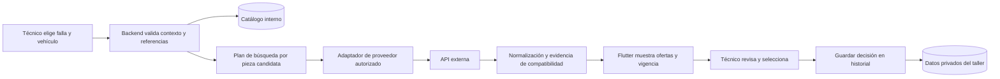

# Factibilidad de búsqueda de repuestos mediante APIs externas

Fecha de revisión: 31 de octubre de 2026. Actualizado sobre `feat/integracion_api`, después de integrar autenticación. Alcance: Flutter, Dart Frog, SQL versionado y consultas de catálogo de solo lectura en `C:/__apps/re-app`.

## 1. Resultado y decisión propuesta

**Es técnicamente viable mostrar ofertas provenientes de APIs en el módulo de búsqueda. La viabilidad de producción depende de conseguir acceso autorizado y datos útiles de al menos un proveedor.** No es un cambio de URL: el listado actual representa repuestos del catálogo interno con margen del taller; el nuevo listado representaría publicaciones de vendedores, con información y vigencia diferentes.

Se propone conservar PostgreSQL para identidad del taller, vehículos, DTC, componentes y referencias verificadas. Las APIs aportarían las ofertas comerciales. Así, el listado puede mostrar exclusivamente ofertas externas sin eliminar la base de conocimiento local.

El objetivo de negocio es que un técnico evalúe alternativas y pueda registrar la opción preferida para una atención. En la consulta de solo lectura de esta revisión, P0301 devolvió tres componentes: bobina de encendido, bujía e inyector de combustible. El vehículo opcional de la captura no está seleccionado, por lo que tampoco existe allí una compatibilidad concreta que podamos trasladar al marketplace. Consultar, seleccionar y comprar son operaciones diferentes. Una falla OBD-II orienta la evaluación; no demuestra qué pieza está dañada ni equivale a un código de producto.

| Dimensión                              | Evaluación                                    | Condición para avanzar                                                               |
| -------------------------------------- | --------------------------------------------- | ------------------------------------------------------------------------------------ |
| Arquitectura Flutter y Dart Frog       | Viable con cambios acotados por módulo        | Nuevo contrato de ofertas, adaptadores y orquestación                                |
| Compatibilidad de la pieza             | Parcial con los datos actuales                | Referencia de fabricante, motor/versión cuando proceda y evidencia de compatibilidad |
| Acceso a los cuatro proveedores        | No validado para nuestras cuentas             | Piloto autorizado y revisión del modelo comercial                                    |
| Visualizar ofertas sin guardarlas      | No exige por sí solo nuevas tablas de negocio | Política de caché y tratamiento de errores                                           |
| Guardar la selección en historial      | Viable, todavía sin implementar               | Modelo de decisión del taller y retención permitida por proveedor                    |
| Sustitución simultánea por cuatro APIs | No recomendada para el primer incremento      | Validar un proveedor antes de multiplicar dependencias                               |

## 2. Traza actual comprobada en código

Los cinco endpoints de búsqueda están conectados al backend; el perfil del explorador relaciona nueve tablas. El índice sintáctico reconoce 233 archivos, 12 rutas API y 21 tablas declaradas en el workspace completo. Es evidencia estática: no demuestra las filas que contiene la base viva ni la respuesta de un proveedor.

```mermaid
flowchart LR
    A[ManualSearchScreen] --> B[CatalogSearchController.searchParts]
    B --> C[ApiSearchRepository.parts]
    C --> D[GET /catalog/dtc/:code/parts]
    D --> E[CatalogService.parts]
    E --> F[CatalogRepository.parts]
    F --> G[(PostgreSQL)]
    G --> H[CatalogDto del backend]
    H --> I[CatalogDto de Flutter]
    I --> J[PartResultCard]
```



| Paso                     | Origen y líneas comprobadas                                                                                                                                                                                                | Comportamiento                                                                          |
| ------------------------ | -------------------------------------------------------------------------------------------------------------------------------------------------------------------------------------------------------------------------- | --------------------------------------------------------------------------------------- |
| Composición real         | [Flutter main.dart](../../Repuestos-Exactos/lib/main.dart), 54–60 y 75–79                                                                                                                                                  | Inyecta `ApiSearchRepository`; no usa un fake por defecto                               |
| Entrada al módulo        | [app_router.dart](../../Repuestos-Exactos/lib/core/routing/app_router.dart), 34–41                                                                                                                                         | La ruta de pantalla `/search` crea el controlador y ejecuta `initialize()`              |
| Acción del usuario       | [manual_search_screen.dart](../../Repuestos-Exactos/lib/features/search/presentation/views/manual_search_screen.dart), 40–67 y 119–122                                                                                     | El botón ejecuta `searchParts`; los resultados se dibujan como `PartResultCard`         |
| Validación y carga       | [catalog_search_controller.dart](../../Repuestos-Exactos/lib/features/search/presentation/controllers/catalog_search_controller.dart), 255–300                                                                             | Exige DTC seleccionado; valida modelo/año y consulta el repositorio                     |
| Petición HTTP            | [api_search_repository.dart](../../Repuestos-Exactos/lib/features/search/data/repositories/api_search_repository.dart), 40–48                                                                                              | Envía DTC, UUID del modelo, año, `offset` y `limit` a nuestra API                       |
| Ruta del backend         | [parts.dart](../routes/catalog/dtc/[code]/parts.dart), 8–23                                                                                                                                                                | Valida parámetros, comprueba DTC y serializa la página del servicio                     |
| Servicio                 | [catalog_service.dart](../lib/features/catalog/services/catalog_service.dart), 34–50                                                                                                                                       | Delega al repositorio, pide un elemento adicional y calcula `next_offset`               |
| SQL                      | [catalog_repository.dart](../lib/features/catalog/repositories/catalog_repository.dart), 78–107                                                                                                                            | Lee repuestos locales disponibles, compatibilidad y configuración del taller            |
| Contrato de salida       | [CatalogDto del backend](../lib/features/catalog/dto/catalog_dto.dart), 30–50                                                                                                                                              | Devuelve UUID internos, perfil, marca, referencia, durabilidad, riesgo, precio y moneda |
| Interpretación y tarjeta | [CatalogDto de Flutter](../../Repuestos-Exactos/lib/features/search/data/models/catalog_dto.dart), 97–135; [PartResultCard](../../Repuestos-Exactos/lib/features/search/presentation/widgets/part_result_card.dart), 10–68 | Valida datos obligatorios y muestra precio con margen, durabilidad y riesgo             |

La consulta SQL utiliza `dtc_catalogo`, `v_dtc_repuesto`, `componente_repuesto`, `repuesto`, `taller_configuracion`, `compatibilidad_repuesto` y `modelo_vehiculo`. La vista deriva DTC → componente → repuesto; no es un diagnóstico mecánico confirmado. Ver [V002](../../RE-db/db/migrations/V002__tablas_catalogos.sql), 32–117.

Los endpoints auxiliares son `GET /catalog/brands`, `GET /catalog/brands/:brand/models`, `GET /catalog/dtc` y `GET /search?vin=...`. Este último busca un vehículo visible **ya registrado en el taller**. Ni el buscador de marcas/modelos ni el VIN local son una búsqueda externa de ofertas. El DTO del vehículo no entrega motor o versión al frontend: [VehicleDto](../lib/features/vehicles/dto/vehicle_dto.dart), 6–18.

La [traza estructurada](evidencia/traza_busqueda_apis.json) conserva evidencias, hashes y versiones de los repositorios.

## 3. Qué cambia al usar ofertas externas

| Contrato actual                         | Necesidad del nuevo listado                                                                                               |
| --------------------------------------- | ------------------------------------------------------------------------------------------------------------------------- |
| Repuesto interno con UUID               | Publicación identificada por proveedor, marketplace, ID y variante; no forzar el ID externo al validador UUID             |
| Un DTC entrega repuestos del catálogo   | Primero determinar componente y referencia candidata; después buscar ofertas para esa necesidad                           |
| Modelo interno y año                    | Traducir a atributos del proveedor; pedir motor/versión cuando sean necesarios                                            |
| `precio_venta` entero y `BigInt`        | Importe decimal exacto y moneda original; no pasar USD con centavos por el parser de enteros                              |
| Margen aplicado automáticamente         | Precio del vendedor claramente separado de una futura cotización del taller                                               |
| Durabilidad y riesgo obligatorios       | Campos desconocidos o ausentes; no inventar esos valores para hacer pasar la validación                                   |
| Perfil genuino/OEM/genérico obligatorio | Clasificación solo si tiene respaldo; no deducir calidad por precio ni aceptar una afirmación comercial como verificación |
| `disponible` local                      | Disponibilidad consultada, desconocida, agotada o vencida según evidencia externa                                         |
| Un único `offset` y orden local         | Continuación opaca por búsqueda/proveedor y deduplicación de publicaciones, no de piezas equivalentes                     |
| Error o página completa                 | Resultados parciales con estado por proveedor; distinguir cero resultados de fallo de acceso                              |

La tarjeta actual no incluye vendedor, enlace, fecha de consulta, costo de envío ni acción de selección. Su texto “Precio de referencia con margen del taller” no describe un precio externo. Tampoco corresponde reutilizar “Compatibilidad filtrada por modelo y año” como promesa de compatibilidad para publicaciones que solo coinciden por palabras.

## 4. Evaluación del documento y de los proveedores

El PDF recibido tiene dos páginas y presenta Mercado Libre, AliExpress, Amazon y eBay. Es una lista de candidatos, no un contrato de API ni una aprobación de uso. El análisis de producción debe validar permisos, cobertura de Chile, condiciones de exhibición/retención y costos efectivos para nuestra cuenta.

### Mercado Libre

El recurso de productos documenta búsquedas por Part Number o Product ID, orientadas al catálogo y a integraciones de publicación. Eso no prueba acceso a todas las ofertas de vendedores externos ni asegura precio y stock utilizables en nuestro comparador. Las referencias oficiales consultadas muestran cambios en recursos de ítems (incluido el reemplazo de consultas múltiples por `/items/bulk` y `/users/bulk`); varias páginas devolvieron 403 al abrirse desde la herramienta, aunque sus extractos oficiales eran accesibles. Ese bloqueo documental no demuestra una caída de la API.

**Factibilidad condicionada:** validar con una aplicación autorizada una pieza de referencia conocida, el recurso permitido para publicaciones de terceros y los campos reales de precio, vendedor, envío y compatibilidad para Chile. No comprometer una búsqueda general basándose en un ejemplo histórico de `/sites/MLC/search`. [ML1][ML2]

### eBay

Browse documenta búsqueda de publicaciones y verificación de compatibilidad. Una búsqueda puede devolver coincidencias parciales; no debe etiquetarse todo como compatible. Para automóviles del mercado estadounidense, la comprobación documentada utiliza año, marca, modelo, versión y motor. La documentación publica grupos de cuota predeterminada de 5.000 llamadas diarias para Browse, no los 1,5 millones sugeridos por el PDF. El acceso de producción y el modelo aprobado deben confirmarse según los requisitos de Buy APIs; Sandbox no acredita producción ni cobertura chilena. [EB1][EB2][EB3]

**Factibilidad técnica favorable para un piloto**, condicionada a habilitación y a encontrar vehículos/piezas relevantes para los talleres objetivo. No aplicar requisitos de checkout a nuestro flujo de consulta y selección.

### AliExpress

La revisión anterior identificó documentación histórica de `aliexpress.affiliate.product.query`, con búsqueda y campos comerciales, bajo una categoría deprecada. En esta nueva consulta, los enlaces históricos agotaron el tiempo de espera y el portal actual no pudo abrirse. No se confirmó un contrato de API vigente ni el acceso de nuestra cuenta.

**Factibilidad pendiente de validar versión y acceso vigentes.** Confirmar método admitido por la aplicación aprobada, variantes, envío a Chile y retención. Un método que no exige autorización de usuario no es por ello una API anónima: los ejemplos documentados exigen AppKey y firma. No reutilizar endpoints antiguos ni asumir una licencia irrestricta sobre las imágenes. [AE1][AE2]

### Amazon

Creators API es la sucesora documentada de PA-API 5. La documentación actual enumera 10 ventas calificadas en los últimos 30 días, además de aceptación del programa y credenciales; las tres ventas en 180 días del PDF no bastan para afirmar acceso. [AM1][AM2]

Las condiciones consultadas exigen una finalidad de promoción y generación de ventas en Amazon. Para aplicaciones móviles contemplan aprobación y acceso gratuito a los enlaces. **Esto necesita validación expresa para un producto comercial destinado a talleres.** La licencia restringe el almacenamiento de contenido e imágenes; la guía técnica indica una hora de caché para Offers. No tratar 24 horas como permiso general de archivo histórico ni afirmar sincronización instantánea obligatoria. [AM3][AM4]

**No usar Amazon como dependencia del primer incremento** sin resolver elegibilidad, encaje del uso y retención.

### Selección del primer proveedor

| Candidato     | Utilidad a comprobar                         | Condición de entrada al piloto                     |
| ------------- | -------------------------------------------- | -------------------------------------------------- |
| Mercado Libre | Ofertas relevantes para Chile                | Acceso autorizado a las publicaciones necesarias   |
| eBay          | Identificación y compatibilidad documentadas | Acceso habilitado y cobertura del vehículo/destino |
| AliExpress    | Alternativas de importación                  | API vigente, variantes y condiciones aprobadas     |
| Amazon        | Catálogo comercial adicional                 | Elegibilidad y compatibilidad del modelo de uso    |

La prioridad se decide por evidencia de acceso y cobertura, no por prometer cuatro integraciones gratuitas. La afiliación es una capacidad adicional y puede ser requisito del programa elegido; no sustituye la identificación de la pieza.

## 5. Flujo propuesto



La pantalla puede mostrar solo ofertas externas. Si un proveedor falla y se ofrece catálogo local como alternativa, debe indicarse explícitamente su origen; no presentar datos locales como una consulta externa exitosa.

Un DTC puede relacionarse con varios componentes. El plan debe incluir un paso de selección de componente o agrupar resultados por necesidad, con referencia de fabricante cuando exista. Si no hay una referencia confiable, mostrar candidatos por revisar; enviar únicamente `P0300` como texto a un marketplace no constituye una identificación de piezas.

La respuesta DTC actual entrega el número de componentes, no su lista. Hace falta exponer las necesidades candidatas, por ejemplo mediante una nueva operación de consulta de componentes por DTC, antes de permitir esa selección. Esta consulta debe partir de `dtc_componente` y no depender exclusivamente de `parts()`: su SQL actual exige un repuesto local disponible y podría ocultar una necesidad para la que sí existe una oferta externa.

## 6. Arquitectura y contrato propuestos

Crear un módulo `lib/features/offers/` con entidades/DTO, servicio coordinador y adaptadores de proveedor, manteniendo SQL en repositorios. Flutter seguirá consumiendo nuestra API; las claves y renovaciones de tokens permanecen en el servidor. La identidad del taller procede de la sesión, no de parámetros enviados por el cliente.

Se propone una ruta nueva, **todavía inexistente**, `POST /offers/search`, con contexto de DTC/componente, modelo/año y referencia candidata; sesión/vehículo opcionales para preparar una selección posterior. Validar pertenencia al taller cuando se incluyan. Una búsqueda independiente no debe crear una atención automáticamente.

Mantener el endpoint local actual hasta migrar el consumidor. Agregar simplemente `source=external` hoy produciría un parámetro no admitido: `PartSearchQuery.parse`, líneas 15–29, utiliza un contrato cerrado.

La respuesta necesita una entidad de oferta distinta de `CatalogPart`/`PartResult`. Este esquema es conceptual, no un payload real ni un contrato implementado:

```json
{
  "search_id": "identificador_opaco_de_busqueda",
  "status": "complete",
  "data": [
    {
      "provider": "proveedor_piloto",
      "marketplace": "mercado_validado",
      "external_id": "publicacion_ejemplo",
      "variant_id": null,
      "title": "Pieza candidata de ejemplo",
      "manufacturer_reference": null,
      "seller_name": null,
      "price": { "amount": "49.90", "currency": "USD" },
      "shipping": { "amount": null, "currency": null, "destination": "CL" },
      "availability": "unknown",
      "compatibility": { "status": "unverified", "evidence": null },
      "url": "https://proveedor.example/publicacion_ejemplo",
      "queried_at": "2026-10-31T18:00:00Z",
      "expires_at": null
    }
  ],
  "providers": [{ "provider": "proveedor_piloto", "status": "ok" }],
  "next_cursor": null
}
```

`unknown` no significa agotado; envío desconocido no significa gratis. `expires_at` debe calcularse según el proveedor y campo, no dejarse indefinido por comodidad. La compatibilidad del proveedor y la revisión del técnico deben tener procedencias separadas.

Para varias APIs, agrupar páginas por proveedor inicialmente. No prometer un orden global exacto por precio con resultados parciales. La identidad y deduplicación se basan en proveedor/mercado/publicación/variante, sin fusionar vendedores de una misma pieza. El cursor debe estar vinculado a filtros y contexto autorizado; no aceptar una URL de continuación arbitraria del cliente.

## 7. Puntos críticos del backend

**Transacción abierta durante la espera externa.** `authentication_middleware.dart`, 57–67, envuelve el handler autenticado en `withUserTransaction`; `database.dart`, 93–133, mantiene ese alcance mientras ejecuta `action`. Introducir llamadas de red dentro de `CatalogService.parts` conservaría una conexión y transacción durante la espera del proveedor. Es un riesgo de la propuesta, no un fallo de rendimiento ya medido.

El diseño debe usar transacciones cortas para revalidar identidad y leer referencias, cerrar ese alcance, consultar proveedores y abrir otra transacción autenticada si hay que guardar. Esto requiere adaptar de forma focalizada la orquestación/autenticación del módulo; añadir otra ruta sin atender el middleware global no resuelve el problema. Conservar RLS y revalidación antes de escribir.

**Errores con origen correcto.** El middleware actual transforma `SocketException` en `database_unavailable` (líneas 91–92). Los adaptadores deben convertir sus fallos en resultados/errores de proveedor; un timeout externo no debe anunciar que PostgreSQL cayó.

**Presupuesto de espera.** Flutter tiene `receiveTimeout` de 10 segundos en `api_client.dart`, 6–11. Definir un presupuesto de backend compatible, concurrencia limitada, límites por taller/proveedor y reintentos acotados de consultas idempotentes. Si un proveedor excede el plazo, devolver estado parcial o pendiente, no mantener la pantalla indefinidamente. Una cola de trabajos solo se justifica si el piloto muestra que la consulta síncrona no cumple el presupuesto.

## 8. Precio y compatibilidad como reglas de negocio

- Conservar importe decimal exacto y moneda original; evitar `double` como representación monetaria. Elegir una convención única de decimales o unidades menores con escala explícita.
- No ordenar CLP, USD y otras monedas por su valor numérico sin conversión. Una conversión requiere fuente, fecha y tasa; debe verse como estimación separada del precio del vendedor.
- Separar precio de pieza, cantidad/unidad/kit, envío e impuestos conocidos. Si faltan, no afirmar un costo final comparable.
- El margen del taller pertenece a su futura cotización. No alterar el precio externo presentado como precio del proveedor.
- No trasladar las etiquetas locales de riesgo, durabilidad o genuino/OEM a una publicación sin evidencia independiente.
- Motor y versión pueden ser necesarios: el modelo de compatibilidad actual relaciona repuesto, modelo y rango de años. Los UUID locales no son identificadores de compatibilidad de los marketplaces.
- La revisión del técnico sigue siendo necesaria. Una coincidencia por título y la validación de una pieza para un vehículo tampoco demuestran que esa pieza resuelva la falla.

## 9. Qué guardar en PostgreSQL

Para visualizar ofertas no es obligatorio persistir cada resultado ni convertirlo en `repuesto`. Mantener separados:

| Concepto                   | Persistencia propuesta                                                                                   |
| -------------------------- | -------------------------------------------------------------------------------------------------------- |
| Referencia técnica interna | Componentes, códigos y compatibilidades verificadas del catálogo                                         |
| Oferta consultada          | Referencia externa y caché con vencimiento, solo campos permitidos                                       |
| Decisión del taller        | Sesión, falla o fallas evaluadas, vehículo, opción elegida, autor, fecha, motivo y evidencia de revisión |

Guardar la decisión del taller no da permiso para conservar indefinidamente el contenido del proveedor. Una selección puede mantener su referencia permitida y mostrar que el precio venció o que la publicación ya no está disponible. No solucionar restricciones copiando el mismo precio a una tabla llamada snapshot.

`cotizacion` y `cotizacion_detalle` ya existen en [V003](../../RE-db/db/migrations/V003__tablas_operativas.sql), 311–380. El detalle referencia un repuesto interno y obliga a una fórmula de precio con margen. No modela proveedor/publicación ni una selección directamente asociada a la falla. Reutilizarlo para ofertas sin adaptar reglas y triggers sería incorrecto. El nuevo modelo de selección requiere diseño, migración y RLS propios; no es necesario adelantar una cotización formal para habilitar la búsqueda.

## 10. Cambios y validación necesarios

| Capa                        | Cambio focalizado                                                                                            |
| --------------------------- | ------------------------------------------------------------------------------------------------------------ |
| Flutter dominio/datos       | Entidad y DTO de oferta, referencia de búsqueda y paginación nueva; conservar validación estricta            |
| Flutter presentación        | Tarjeta con proveedor, moneda, vigencia, envío y compatibilidad; estados parciales y selección de componente |
| Backend                     | Ruta y módulo de ofertas, adaptador inicial, mapeo de referencias, caché, cuotas y errores tipados           |
| Autenticación/transacciones | Orquestar la espera externa fuera de la transacción manteniendo contexto y revalidación                      |
| Base de datos               | Conservar catálogos; agregar selección e integración solamente cuando se implemente el guardado              |
| Historial                   | Añadir consulta de selecciones por atención, sin confundir selección con compra o cotización cerrada         |

Pruebas de aceptación del piloto:

1. Referencia conocida: se devuelve la publicación correcta y su variante; la evidencia de compatibilidad corresponde al vehículo.
2. Coincidencia ambigua: se muestra como pendiente de revisión, sin afirmar genuino/OEM ni inventar riesgo o durabilidad.
3. DTC válido sin referencias: se solicita refinar la necesidad, sin fabricar una pieza.
4. Cero resultados, proveedor no autorizado, cuota excedida y timeout: estados distinguibles; los fallos externos no se etiquetan como caída de base.
5. Monedas/decimales, kits y envío desconocido: importes exactos y comparación honesta.
6. Cambio rápido de filtros y paginación: ninguna respuesta vieja sustituye resultados nuevos; no se duplican publicaciones.
7. Cuando se agregue guardado: aislamiento entre talleres, idempotencia, trazabilidad y rechazo de referencias manipuladas o datos vencidos según la política acordada.
8. Regresión: login, búsqueda DTC, catálogo de vehículos e historial conservan comportamiento y permisos.

Las pruebas existentes relevantes son `catalog_dto_test.dart`, `search_controller_test.dart`, `search_screen_test.dart`, `search_api_integration_test.dart`, y las pruebas de catálogo del backend. Son puntos de partida; el análisis no equivale a haber ejecutado una integración externa.

## 11. Implementación por etapas y esfuerzo relativo

1. **Desbloqueo de datos:** seleccionar un proveedor y validar acceso, licencia para nuestro uso y cobertura con tres casos reales: compatible, ambiguo y sin resultados. Sin esto, el costo/calendario de producción no es estimable de forma responsable.
2. **Primer listado externo:** un proveedor, una necesidad por búsqueda y datos normalizados. Esfuerzo medio en Flutter y medio/alto en backend por contrato y transacciones. Aceptar resultados desconocidos sin completar campos inventados.
3. **Selección en historial:** definir permisos, campos conservables y estados; agregar persistencia y lectura. Esfuerzo medio/alto por integración con sesión/falla y reglas de retención.
4. **Segundo proveedor:** añadir adaptador y continuación por fuente, conservar ofertas distintas y medir cuotas/latencia. No presupone resolver automáticamente equivalencias entre piezas.

La recomendación es avanzar al piloto de un proveedor, no sustituir de una vez el contrato actual por cuatro respuestas heterogéneas.

Para dimensionar cuotas, estimar por proveedor: talleres activos × búsquedas por día × componentes consultados × páginas solicitadas, agregando llamadas de detalle/verificación y descontando solo la caché permitida. Una consulta del usuario puede generar varias llamadas externas. No hay mediciones ni tarifas de nuestras cuentas que permitan prometer un costo mensual o una capacidad concreta.

## 12. Reproducción y límites de la revisión actual

Se releyeron las dos páginas completas del PDF, se renderizaron para inspección y se contrastaron las afirmaciones con documentación oficial accesible. Los bloqueos 403 y los timeouts de documentación se registran como limitación de la consulta, no como prueba de un fallo del API.

Se intentó descubrir y trazar mediante MCP. El grafo sigue apuntando a los repositorios anteriores y la traza de CatalogSearchController no devolvió llamadas. Por ello se verificaron directamente los archivos de los tres checkouts actuales. No se presenta ese índice como evidencia de ejecución end-to-end.

La consulta SQL real y de solo lectura para P0301 confirmó los tres componentes candidatos. Los códigos de fabricante del catálogo proceden de datos de demostración; incluyen referencias sintéticas como GEN-BOB-01. No se certificaron contra fabricantes y no deben usarse como evidencia de compatibilidad comercial sin validación adicional.

Las rutas operativas ya están corregidas: Iniciar-RepuestosExactos.ps1 y main_app/config/workspace.json apuntan a Backend_Repuestos_Exactos. El pendiente de RE-api que documentaba la revisión anterior está resuelto.

No se modificó lógica ejecutable, no se aplicaron migraciones, no se registraron selecciones ni se hicieron compras o llamadas autenticadas a proveedores. No se generaron credenciales. Las pruebas de autenticación previas no prueban acceso ni compatibilidad de marketplaces. Esta revisión documenta diseño y factibilidad; no declara implementado el listado externo.

La evidencia actual se agregó a docs/evidencia/traza_busqueda_apis.json, conservando la revisión original como antecedente. Ninguno de los cuatro proveedores se considera aprobado para nuestra cuenta solamente por aparecer en el PDF.

## 13. Fuentes oficiales y documento aportado

Consulta realizada el 31 de octubre de 2026. Las condiciones deben reconfirmarse con el mercado y aplicación aprobados antes de producción.

- **PDF aportado:** `C:/proyecta/miuaf/db/sql/APIs y Afiliados para Repuestos.pdf`, páginas 1 y 2. No se copia a este repositorio.
- **[ML1]** [Buscador de productos y Part Number](https://developers.mercadolibre.cl/buscador-de-productos). Extracto oficial consultable; apertura completa devolvió 403.
- **[ML2]** [Ítems y búsquedas](https://developers.mercadolibre.cl/es_ar/api-docs-es/items-y-busquedas). Extracto oficial con actualización indicada de septiembre de 2026; acceso completo limitado en esta consulta. No valida permisos de nuestra cuenta chilena.
- **[EB1]** [Browse API y compatibilidad](https://developer.ebay.com/api-docs/buy/static/api-browse.html).
- **[EB2]** [Cuotas de APIs](https://developer.ebay.com/develop/api/buy/api_call_limits).
- **[EB3]** [Requisitos de Buy APIs](https://developer.ebay.com/api-docs/buy/buy-requirements.html). Distinguir los requisitos generales y los específicos de checkout.
- **[AE1]** [aliexpress.affiliate.product.query](https://open.alitrip.com/docs/doc.htm?articleId=45803&docType=2&treeId=674). Documentación oficial bajo categoría deprecada; usar como evidencia de contrato histórico, no como autorización actual.
- **[AE2]** [Guía de acceso de AliExpress](https://open.alitrip.com/docs/doc.htm?articleId=118193&docType=1&treeId=674). Guía antigua; confirmar sustituto en el portal actual.
- **[AM1]** [Creators API y requisitos](https://affiliate-program.amazon.com/creatorsapi/docs/en-us/introduction).
- **[AM2]** [Deprecación de PA-API 5](https://affiliate-program.amazon.com/creatorsapi/docs/en-us/paapiv5-deprecation).
- **[AM3]** [Políticas y licencia del programa](https://affiliate-program.amazon.com/help/operating/policies). Condiciones consultadas de Amazon.com; no extrapolar automáticamente a otro mercado.
- **[AM4]** [Prácticas de Creators API y tiempos de caché](https://affiliate-program.amazon.com/creatorsapi/docs/en-us/concepts/best-programming-practices).

[ML1]: https://developers.mercadolibre.cl/buscador-de-productos
[ML2]: https://developers.mercadolibre.com.ar/es_ar/atributos-y-variaciones/items-y-busquedas
[EB1]: https://developer.ebay.com/api-docs/buy/static/api-browse.html
[EB2]: https://developer.ebay.com/develop/api/buy/api_call_limits
[EB3]: https://developer.ebay.com/api-docs/buy/buy-requirements.html
[AE1]: https://open.alitrip.com/docs/doc.htm?articleId=45803&docType=2&treeId=674
[AE2]: https://open.alitrip.com/docs/doc.htm?articleId=118193&docType=1&treeId=674
[AM1]: https://affiliate-program.amazon.com/creatorsapi/docs/en-us/introduction
[AM2]: https://affiliate-program.amazon.com/creatorsapi/docs/en-us/paapiv5-deprecation
[AM3]: https://affiliate-program.amazon.com/help/operating/policies
[AM4]: https://affiliate-program.amazon.com/creatorsapi/docs/en-us/concepts/best-programming-practices

## 14. Arquitectura propuesta para el incremento

### Límite y secuencia de negocio

1. Flutter conserva el autocompletado DTC y los catálogos de vehículo desde nuestra API.
2. Nueva consulta de componentes del DTC, independiente de la existencia de repuestos locales. El técnico selecciona la necesidad: por ejemplo, revisar alternativas de bobina; el sistema no confirma que esa pieza causó P0301.
3. Se incorpora vehículo/modelo/año y, cuando el proveedor lo requiera, motor/versión. Una referencia puede provenir de una ficha técnica validada o ingresarse para revisión. Los datos semilla no equivalen a una identificación certificada de piezas.
4. El backend construye un plan de búsqueda con palabras, referencia, categoría y atributos del proveedor. No envía el UUID local como si fuera un identificador de vehículo del proveedor. Buscar por palabras sin referencia es permitido como búsqueda exploratoria, con compatibilidad sin verificar.
5. Un adaptador consulta al proveedor aprobado. El servicio normaliza las publicaciones sin añadir margen, durabilidad ni una clasificación OEM inventada.
6. Flutter muestra publicaciones por componente/proveedor con precio original, moneda, vendedor, enlace, vigencia y evidencia de compatibilidad. El técnico puede revisar y luego registrar su selección cuando se implemente esa etapa.

### Separación de responsabilidades en Dart Frog

~~~text
routes/
  catalog/dtc/[code]/components.dart  # propuesta: componentes candidatos
  offers/search.dart                 # propuesta: búsqueda comercial
lib/features/offers/
  models/                            # Offer, OfferPrice, CompatibilityEvidence
  dto/                               # OfferSearchRequest, OfferSearchResponse
  services/                          # OfferSearchService: coordina y normaliza
  repositories/                      # SQL de referencias y selección futura
  providers/
    offer_provider.dart              # contrato común de proveedores
    mercadolibre_offer_provider.dart # sólo si el piloto resulta autorizado
    ebay_offer_provider.dart         # siguiente adaptador posible
~~~

Son nombres y rutas propuestos; no se crearon estos archivos. No hace falta incorporar microservicios para el primer proveedor. La arquitectura actual por funcionalidades puede alojar el módulo. La implementación HTTP, OAuth/firma, paginación y errores propios del proveedor quedan encapsulados en su adaptador. La selección del proveedor se realiza con configuración del servidor, nunca mediante una URL arbitraria recibida del cliente.

El contrato no debe prometer que todos los proveedores publican stock exacto, envío, categoría OEM o compatibilidad verificada. El adaptador declara sus capacidades y el servicio conserva datos ausentes como desconocidos.

### Ciclo de autenticación y transacciones

~~~mermaid
sequenceDiagram
  participant F as Flutter
  participant A as API Dart Frog
  participant D as PostgreSQL
  participant P as API proveedor
  F->>A: Buscar ofertas con Bearer y filtros
  A->>D: Transacción corta: revalidar perfil y leer plan con RLS
  D-->>A: Plan inmutable de búsqueda
  Note over A,D: Transacción cerrada antes de HTTP externo
  A->>P: Consulta autorizada con timeout y límites
  P-->>A: Publicaciones o error tipado
  A-->>F: Ofertas normalizadas y estado del proveedor
  opt Etapa posterior: guardar selección
    F->>A: Confirmar oferta y contexto de atención
    A->>D: Nueva transacción: revalidar, comprobar pertenencia y guardar
    D-->>A: Selección registrada
    A-->>F: Confirmación
  end
~~~

La ruta de ofertas seguirá siendo autenticada. No se añade a publicPaths para sacar la llamada de la transacción. Hay que separar el alcance SQL del alcance del handler mediante una política de ejecución explícita para estas rutas, manteniendo por defecto el comportamiento transaccional de las existentes. El servicio leerá su plan dentro de withUserTransaction y recibirá valores inmutables; no conservará TxSession para los adaptadores de red. El mecanismo concreto se cerrará al implementar y deberá tener pruebas de regresión de permisos.

Propietario y mecánico pueden buscar dentro de su contexto de taller. Al guardar se registra el autor, se vuelven a validar permisos y se comprueba que atención, falla y vehículo pertenezcan al mismo taller. Un resultado externo ni un token de búsqueda conceden acceso a otro taller.

### Nuevo contrato y presentación

- POST /offers/search: DTC completo, componente candidato y filtros técnicos. No admite rol ni taller_id enviados por el cliente. Si hay vehículo registrado, se verifica pertenencia y coherencia con modelo/año. Si no hay vehículo, la consulta es general y debe indicarse.
- GET /catalog/dtc/{code}/components: propuesta de lectura para seleccionar el componente sin exigir un repuesto local disponible.
- Un Offer conserva proveedor, marketplace, publicación, variante, título, importe exacto y moneda, vendedor, enlace permitido, envío conocido/desconocido, consulta, vencimiento y evidencia de compatibilidad.
- Estados de búsqueda: completa, parcial o fallida; además necesidad de refinar datos cuando no se puede construir una consulta útil. Cero resultados es una respuesta exitosa vacía, distinta de falta de autorización o timeout.
- Presupuesto inicial propuesto: respuesta de la API antes de los diez segundos del cliente; por ejemplo, deadline global de ocho segundos y límite menor por proveedor. Son parámetros iniciales a medir, no una latencia garantizada. Limitar solicitudes concurrentes, páginas y consultas por taller/proveedor.
- Conservar cursor opaco y filtros asociados. En el primer proveedor se pagina por su propia continuación; varios proveedores pueden presentarse por pestañas antes de implementar un ranking combinado.

La tarjeta de la captura debe pasar de 'Precio de referencia con margen del taller' a 'Precio informado por el proveedor'. El costo final puede ser desconocido si no hay envío/impuestos; no se presenta como total. Una futura cotización aplica margen por separado. La UI debe mostrar 'Compatibilidad no verificada' cuando sólo haya coincidencia por texto.

### Persistencia por etapas

**Primera etapa: consultar.** No necesita insertar todas las publicaciones en repuesto ni exige una migración de negocio si la caché es temporal y está permitida. Las credenciales permanecen en configuración segura del backend. La caché debe respetar alcance de la cuenta, campos permitidos, TTL y contexto privado; no se comparte información privada entre talleres. La implementación puede iniciar con memoria acotada por instancia si sus limitaciones son aceptables. Redis sólo se justifica al requerir varias instancias o coordinación distribuida.

**Segunda etapa: guardar la opción elegida.** Diseñar una selección propia del taller con taller_id, atención/falla/vehículo cuando corresponda, autor, componente, proveedor, publicación/variante, motivo, estado de revisión y referencia externa conservable. No se persisten payloads completos ni precios indefinidamente por defecto. La caché comercial vencida y la decisión del técnico tienen ciclos de vida distintos.

cotizacion_detalle exige un repuesto interno y mantiene sus propias reglas de precio y cierre. No se debe insertar una publicación externa fingiendo que es ese repuesto para evitar diseñar la selección. Una oferta externa podrá servir como insumo de una cotización cuando se modele esa conversión explícitamente.

### Alcance del primer incremento y criterio de salida

Primero validar Mercado Libre para el mercado chileno con acceso autorizado a ofertas de terceros. Si no habilita ese uso o los datos no alcanzan, evaluar eBay con sus requisitos de producción. Esta es una prioridad propuesta por el negocio objetivo; aún no existe evidencia de acceso aprobada para nuestras cuentas.

Entregar un proveedor, una necesidad por búsqueda, listado externo real, estado vacío/error, paginación, vigencia y compatibilidad explícita. El guardado en historial es la etapa siguiente, salvo que se incluya expresamente en el alcance. Amazon y AliExpress no deben ser dependencias necesarias del primer listado.

La integración se acepta sólo después de comprobar tres ejemplos reales y reproducibles: referencia correcta con evidencia técnica, coincidencia ambigua y búsqueda sin resultado. Añadir timeout/429/credencial inválida, respuesta fuera de orden en Flutter y una prueba que compruebe que la espera HTTP no ocupa una conexión del pool SQL. Las pruebas con respuestas simuladas no acreditan acceso al proveedor.

## 15. Productos guardados frente a cotización

Revisión del código y catálogo de tablas aplicados: la base contiene cotizacion y cotizacion_detalle; no existe aún un modelo específico de selección/oferta externa. GET /sessions sólo admite GET, y su consulta devuelve sesiones de diagnóstico, fallas y total/moneda de la cotización vigente. No devuelve una lista de productos elegidos. El esquema de cotización tiene soporte SQL; esto no equivale a tener un flujo completo de cotización expuesto por API/Flutter.

### Interpretación en el negocio actual

| Acción | Significado propuesto |
|---|---|
| Buscar precios/ofertas | Consultar alternativas, sin crear automáticamente cotización ni atención |
| Guardar alternativa | Registrar una opción que el técnico desea conservar para revisar o elegir después |
| Marcar preferida | Registrar una decisión sobre una alternativa; no significa compra, reparación ni aceptación del cliente |
| Cotizar formalmente | Preparar una propuesta con cantidades, precios, margen, moneda, revisión y total bajo reglas propias |

La estructura actual de cotizacion permite un borrador por sesión y una revisión vigente cerrada. cotizacion_detalle exige repuesto_id interno, cantidades y snapshots; su precio_unitario debe cumplir la fórmula de margen. El trigger de sesiones exige una cotización vigente cerrada para pasar a cotizado o completado. Guardar una alternativa no debe disparar esas transiciones ni cerrar un presupuesto.

### Primer alcance recomendado

Agregar el botón 'Guardar alternativa' a las ofertas. La intención del usuario y sus notas se guardan como datos privados del taller. Cuando exista una atención persistida, la alternativa se relaciona con ella y con su falla. No convertir una búsqueda manual en una sesión OBD que nunca se realizó.

Para una búsqueda manual sin atención existen dos variantes. La primera exige seleccionar una atención existente o implementar su alta manual; hoy POST /sessions no existe. La segunda permite guardar independientemente y muestra las alternativas en una pestaña 'Repuestos guardados' dentro de Historial. Esta segunda variante habilita el primer uso sin depender de implementar el escaneo/alta de diagnósticos. Una relación opcional permite enlazar después una alternativa a una atención real.

El modelo conceptual mínimo puede llamarse producto_guardado o seleccion_repuesto: identificador público, taller, autor, fecha, DTC/componente evaluado, referencia local o proveedor/publicación/variante, notas, estado de selección y atención/vehículo opcionales. Debe distinguirse el origen local del externo y validar coherencia entre sus referencias. La decisión propia del taller se conserva separada de los datos comerciales temporales y de sus reglas de almacenamiento; no se promete archivar precio o imágenes del proveedor indefinidamente.

Si se incluyen precios observados, conservar importe exacto, moneda, fuente, fecha y vigencia únicamente cuando esté permitido; mostrar vencido/no disponible cuando corresponda. No sumar monedas distintas ni interpretar un precio guardado como precio actual o presupuesto garantizado. El servidor resuelve y valida la oferta/referencia; no confía en el precio, el taller o el autor enviados por Flutter.

### Arquitectura y cambios necesarios

- RE-db: nueva migración para selección propia del taller, referencias coherentes, claves compuestas con taller cuando corresponda, RLS, permisos y auditoría. No se modifica cotizacion_detalle para fingir que toda oferta es un repuesto interno.
- Backend: módulo de selecciones con DTO, servicio y repositorio; operación de guardar/listar/descartar y, si se incluye, marcar preferida. Rutas como POST /saved-parts y GET /saved-parts son propuestas, todavía inexistentes. Resolver/actualizar información externa fuera de transacciones SQL y revalidar al escribir.
- Flutter: guardar desde la tarjeta, confirmar el resultado y consultar las alternativas en Historial. Mantener 'Diagnósticos' como listado de sesiones y agregar 'Repuestos guardados' para las selecciones independientes. Dentro del detalle de una atención pueden mostrarse sólo las vinculadas a ella.
- Historial actual: conservar su cursor y semántica. Si se agrega contador de alternativas por sesión, hacerlo mediante agregado para evitar duplicar filas o alterar la paginación. El detalle de productos requiere su propia consulta y pantalla.

Propietario y mecánico trabajan dentro de su taller y cada selección conserva su autor. Las reglas de edición y de preferencia deben cerrarse al implementar; no se otorgan facultades globales ni se cambia la propiedad del taller mediante este módulo.

### Ejemplo y aceptación

Para P0301, el técnico elige evaluar una bobina, consulta ofertas, guarda dos alternativas y marca una preferida si esa capacidad está incluida. En 'Repuestos guardados' ve el contexto, sus notas y el enlace/referencia conservable; si estaba trabajando en una atención, también la encuentra allí. La sesión mantiene su estado de negocio anterior. Consultar la disponibilidad actual es una acción distinta de consultar la decisión histórica.

Validar: persistencia después de cerrar sesión; rechazo de acceso desde otro taller; reintentos sin duplicar el mismo guardado; ofertas de distintos vendedores conservadas por separado; origen/vehículo/falla coherentes; precio vencido visible como tal; búsqueda sin atención registrada como guardado independiente; guardar no crea cotización ni marca la sesión cotizada.

Esta sección es una propuesta de alcance y arquitectura. No se crearon tablas, rutas o pantallas ni se modificó el ciclo de cotización en esta revisión.
